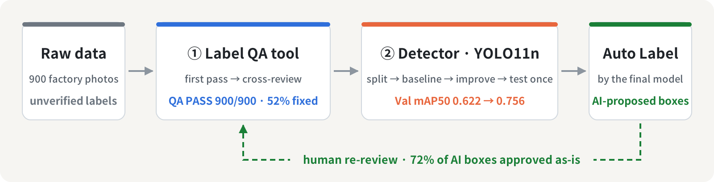
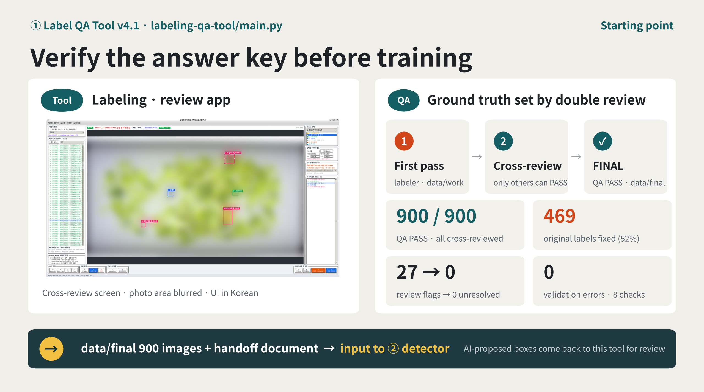
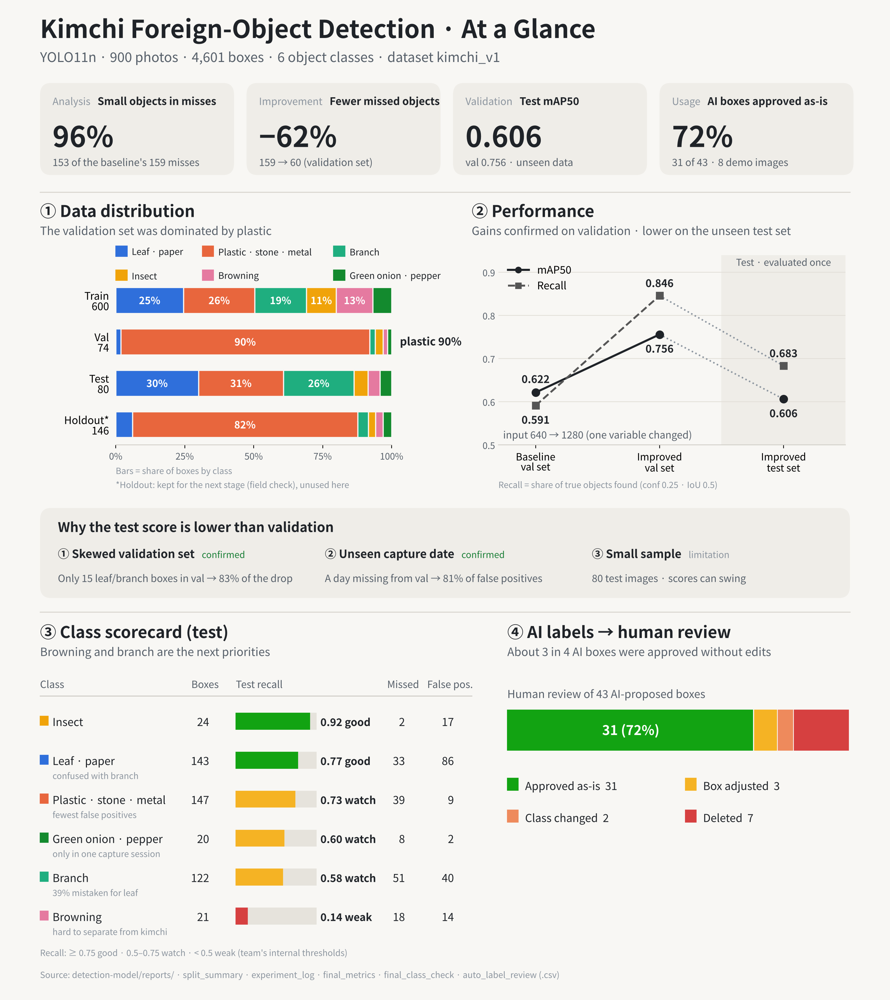

# Kimchi Foreign-Object Detection · From Label QA to Model Validation

[한국어](README.md) | **English**

Using 900 production-line photos of cut kimchi from a food factory, we **built our own label QA tool (①)**, used the verified labels to **train and evaluate a YOLO11n detector (②)**, and fed the model's predictions back into the ① tool for **human review — closing one full data loop**.

> 📑 **Final presentation** (Korean): [PDF](presentation/team01_prj07_prj08.pdf) · [Google Slides](https://docs.google.com/presentation/d/1lfYxkO_q-nYkV291dwh8UB7X9kVs7-QH/preview) · [Figma](https://www.figma.com/design/1B9QcM36Ne1j5sTHXcOAAV/1%EC%A1%B0?node-id=0-1)
> ※ The images are company-provided data under NDA. Raw photos, labels, and model weights are excluded from Git, and every photo shown here is blurred.

## At a Glance

  

| | [① Label QA Tool](./labeling-qa-tool) | [② Foreign-Object Detector](./detection-model) |
|---|---|---|
| **What we did** | Built a label review app (Python · tkinter, v4.1) · first-pass review by 5 people → cross-review by a different person | Split by capture session · YOLO11n baseline → failure analysis → single-variable improvement → frozen test, evaluated once |
| **Key numbers** | QA PASS **900 / 900** · **52% (469 images)** of the original labels corrected · 27 flagged for review → 0 unresolved · 0 self-approvals | Val mAP50 **0.622 → 0.756** · missed objects 159 → 60 · Test mAP50 **0.606** (single run) · **72%** of AI-proposed boxes approved unchanged |
| **Handed off** | Verified dataset (900 images) + handoff document | Final model + handoff document · acceptance test **33 / 33** |
| **Records** | [README](./labeling-qa-tool) · [Code review](labeling-qa-tool/docs/code_review/README.md) · Release `v4.1` | [README](./detection-model) · [Code review](detection-model/docs/code_review/README.md) · Tag `subject8_final_v1` |

<table>
  <tr>
    <td width="50%"></td>
    <td width="50%"></td>
  </tr>
  <tr>
    <td align="center">① Label QA · 900 images, double review</td>
    <td align="center">② Detector · training, evaluation, and auto-label results</td>
  </tr>
</table>

Detailed documents in each folder are in Korean.

## Key Findings

- **Most misses were small objects.** 153 of the baseline's 159 missed objects were small. Changing only the input size (640 → 1280) cut misses by 62% (159 → 60) and false positives from 92 to 41 on the same validation set.
- **The test score dropped, and we traced why.** The final model was locked before the test set was opened, then evaluated once (mAP50 0.756 on validation → 0.606 on test). The drop came from a validation set that was 90% plastic objects, and from a capture date that never appeared in validation.
- **No leakage by design.** The data was split by 5-minute capture session (600 / 74 / 80 / 146), so near-duplicate frames never cross between train, validation, and test.
- **Known weakness, stated openly.** Browning/disease spots remain hard (test recall 0.14): the model confuses them with the kimchi background. This is the top priority for the next iteration.

## My Role — Yong Hoon Choi (PM / Integrator)

> As PM of a five-person team, I defined the quality criteria for data and models, and verified and integrated teammates' work into `main` through pull-request review.

| Metric | Value |
|---|---|
| Commits (excluding merges) | **145 of 205 (71%)** · as of Oct 22 |
| PRs reviewed and merged | **130 of 153** · all **82** during the detection-model phase (PM-only merge rule) |
| Duration | Oct 2 – Oct 22, 2026 (3 weeks) |

<b>What I built</b> — QA tool architecture · cross-review rule · data split design · final model · acceptance 33/33

**① Label QA Tool**
- Refactored a single `app.py` into feature modules (ui · bbox · yolo · records · qa · validation) ([#1])
- Designed the `data/raw → work → final` pipeline; nothing reaches `final` without passing review ([#6])
- Designed the cross-review rule: reviewers cannot approve images they labeled themselves
- Automated QA summary and handoff document generation · merged five reviewers' results · dataset manifest · acceptance test
- Personally reviewed 150 images (first pass) and 83 images (cross-review)

**② Detection Model**
- Locked dataset version `kimchi_v1` after tracing a mismatch between documented (4,602) and actual (4,601) bounding boxes ([#67])
- Designed and implemented the data split: capture-session and leakage analysis → session-level split 600/74/80/146 (8/8 acceptance criteria) → freeze script ([#70], [#81])
- Trained and evaluated the baseline ([#92]) → designed experiment exp001 from failure analysis ([#104])
- Selected the final model → single frozen-test evaluation ([#111]) → acceptance 33/33 and handoff ([#117])

**Post-course cleanup**
- Found and fixed an installation bug during a clean install: `requirements.txt` required pandas 3.x, which cannot be installed on the project's Python 3.10 ([#157])
- Reorganized folders and terminology; updated NDA protection rules (`.gitignore`) for the new folder names

<b>Team</b> — Yong Hoon Choi (PM) · Geon Park · Junhyeong Sim · Hamin Kim · Seunghoon Lee

| Member | ① Label QA role | ② Detection model role |
|:-:|---|---|
| Yong Hoon Choi [`@yonghoonchoi88`](https://github.com/yonghoonchoi88) | PM / Integrator | PM / Integrator |
| Geon Park [`@howolcat`](https://github.com/howolcat) | Program / Validation | Evaluation / Failure · Experiment |
| Junhyeong Sim [`@simpson92`](https://github.com/simpson92) | QA / Test | Data / QA · Training |
| Hamin Kim [`@hxxdxm`](https://github.com/hxxdxm) | Docs / Guide | Inference / Document |
| Seunghoon Lee [`@lee26060715`](https://github.com/lee26060715) | Feature / Record | — |

<b>Tech &amp; Rules</b> — Python 3.10 · PyTorch 2.14.1 · Ultralytics 8.4.175 · NDA data excluded from Git

- **Environment**: Python 3.10 · PyTorch 2.14.1 · Ultralytics 8.4.175 · RTX 3060 (identical versions on all five machines)
- **Collaboration**: personal branch → pull request → merge into `main` · PM-only merges from the detection-model phase onward
- **Security**: raw data, training outputs, and weights are excluded via `.gitignore` (NDA)

[#1]: https://github.com/yonghoonchoi88/kimchi-foreign-object-detection/pull/1
[#6]: https://github.com/yonghoonchoi88/kimchi-foreign-object-detection/pull/6
[#67]: https://github.com/yonghoonchoi88/kimchi-foreign-object-detection/pull/67
[#70]: https://github.com/yonghoonchoi88/kimchi-foreign-object-detection/pull/70
[#81]: https://github.com/yonghoonchoi88/kimchi-foreign-object-detection/pull/81
[#92]: https://github.com/yonghoonchoi88/kimchi-foreign-object-detection/pull/92
[#104]: https://github.com/yonghoonchoi88/kimchi-foreign-object-detection/pull/104
[#111]: https://github.com/yonghoonchoi88/kimchi-foreign-object-detection/pull/111
[#117]: https://github.com/yonghoonchoi88/kimchi-foreign-object-detection/pull/117
[#157]: https://github.com/yonghoonchoi88/kimchi-foreign-object-detection/pull/157
