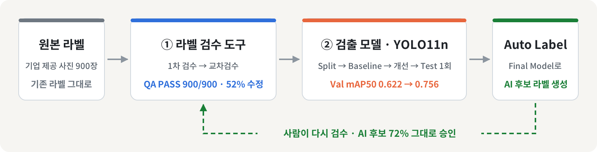

# 조각김치 이물 검출 · 라벨 검수부터 모델 검증까지

식품 공장의 조각김치 이물 사진 900장으로 **라벨 검수 도구를 직접 만들고(①)**, 그 정답지로 **YOLO11n 검출 모델을 학습 · 평가한 뒤(②)**, 모델이 만든 라벨을 다시 ① 도구로 사람이 검수하는 **한 사이클**을 완성했습니다.

> 📑 **최종 발표 자료**: [PDF](presentation/team01_prj07_prj08.pdf) · [Google Slides](https://docs.google.com/presentation/d/1lfYxkO_q-nYkV291dwh8UB7X9kVs7-QH/preview) · [Figma](https://www.figma.com/design/1B9QcM36Ne1j5sTHXcOAAV/1%EC%A1%B0?node-id=0-1)
> ※ 회사 데이터(NDA) 보호를 위해 원본 사진 · 라벨 · 모델은 Git에 올리지 않았고, 모든 사진은 blur 처리했습니다.

## 한눈에 보기

  

| | [① 라벨 검수 도구](./labeling-qa-tool) | [② 이물 검출 모델](./detection-model) |
|---|---|---|
| **한 일** | Python · tkinter로 라벨 검수 프로그램 v4.1 제작 · 5명 1차 검수 → 다른 사람 교차검수 | 촬영 세션 단위 Split · YOLO11n Baseline → 실패 분석 → 변수 1개 개선 → Frozen Test 1회 |
| **핵심 숫자** | QA PASS **900 / 900** · 기존 라벨 **52%(469장)** 수정 · REVIEW 27 → 미해결 0 · 본인 PASS 0건 | Val mAP50 **0.622 → 0.756** · 놓침 159 → 60 · Test mAP50 **0.606** (1회) · AI 후보 **72%** 그대로 승인 |
| **넘긴 것** | FINAL 900장 + 검출 모델 단계 인계 문서 | Final Model + 후속 프로젝트 인계 · Acceptance **33 / 33** |
| **기록** | [README](./labeling-qa-tool) · [코드 리뷰](labeling-qa-tool/docs/code_review/README.md) · Release `v4.1` | [README](./detection-model) · [코드 리뷰](detection-model/docs/code_review/README.md) · Tag `subject8_final_v1` |

<table>
  <tr>
    <td width="50%"></td>
    <td width="50%"></td>
  </tr>
  <tr>
    <td align="center">① 라벨 검수 · 900장 이중 검수</td>
    <td align="center">② 검출 모델 · 학습 · 평가 · 자동 라벨 결과</td>
  </tr>
</table>

## 내 역할 — 최용훈 (PM / Integrator)

> 5인 팀의 PM으로 데이터 · 모델의 품질 기준을 정하고, 팀원 작업을 PR 리뷰로 검증해 `main`에 통합했습니다.

| 지표 | 값 |
|---|---|
| 커밋 (merge 제외) | **205개 중 145개 (71%)** · 10/22 기준 |
| PR 리뷰 · merge | **153건 중 130건** · 검출 모델 단계는 **82건 전부** (팀장만 merge 규칙) |
| 기간 | 2026-10-02 ~ 10-22 (3주) |

<b>직접 한 일</b> — 검수 도구 구조 설계 · 교차검수 규칙 · Split 설계 · Final Model · Acceptance 33/33

**① 라벨 검수 도구**
- 단일 `app.py`를 기능별 모듈(ui · bbox · yolo · records · qa · validation)로 분리 ([#1])
- `data/raw → work → final` 3단 구조 · 수정 없이 final로 직행 금지 규칙 ([#6])
- 교차검수 규칙 설계: 본인이 1차 검수한 이미지는 본인이 PASS 불가
- QA Summary · Handoff 문서 자동 생성 · 5명 결과 취합 · Dataset Manifest · Acceptance Test
- 직접 검수: 1차 150장 · 교차검수 83장

**② 검출 모델**
- Dataset Version `kimchi_v1` 확정: 문서상 BBox 4,602개와 실제 4,601개의 차이를 추적 ([#67])
- Split 설계 · 구현: 촬영 세션 · Leakage 분석 → 세션 단위 배정 600/74/80/146 (합격 기준 8/8) → Freeze 스크립트 ([#70], [#81])
- Baseline 학습 · 평가 ([#92]) → 실패 분석 기반 exp001 설계 ([#104])
- Final Model 확정 → Frozen Test 1회 평가 ([#111]) → Acceptance 33/33 · 인계 ([#117])

**포트폴리오 정리 (수료 후)**
- 클린 설치 중 `requirements.txt` 오류 발견 · 수정: pandas 3.x 요구로 Python 3.10에서 설치 불가 ([#157])
- 폴더 · 용어 정리, 새 폴더 이름에 맞춰 NDA 보호 규칙(`.gitignore`) 갱신

<b>팀</b> — 최용훈 PM · 박건 · 심준형 · 김하민 · 이승훈

| 팀원 | ① 라벨 검수 역할 | ② 검출 모델 역할 |
|:-:|---|---|
| 최용훈 [`@yonghoonchoi88`](https://github.com/yonghoonchoi88) | PM / Integrator | PM / Integrator |
| 박건 [`@howolcat`](https://github.com/howolcat) | Program / Validation | Evaluation / Failure · Experiment |
| 심준형 [`@simpson92`](https://github.com/simpson92) | QA / Test | Data / QA · Training |
| 김하민 [`@hxxdxm`](https://github.com/hxxdxm) | Docs / Guide | Inference / Document |
| 이승훈 [`@lee26060715`](https://github.com/lee26060715) | Feature / Record | — |

> 자세한 작업 내용은 각 프로젝트 README의 **팀** 표를 참고합니다.

<b>기술 · 규칙</b> — Python 3.10 · PyTorch 2.14.1 · Ultralytics 8.4.175 · NDA 데이터 Git 제외

- **환경**: Python 3.10 · PyTorch 2.14.1 · Ultralytics 8.4.175 · RTX 3060 (5명 동일 버전)
- **협업**: 개인 branch → Pull Request → `main` merge · 검출 모델 단계부터 팀장만 merge
- **보안**: 원본 데이터 · 학습 결과 · 가중치는 `.gitignore`로 제외 (NDA)

[#1]: https://github.com/yonghoonchoi88/kimchi-foreign-object-detection/pull/1
[#6]: https://github.com/yonghoonchoi88/kimchi-foreign-object-detection/pull/6
[#67]: https://github.com/yonghoonchoi88/kimchi-foreign-object-detection/pull/67
[#70]: https://github.com/yonghoonchoi88/kimchi-foreign-object-detection/pull/70
[#81]: https://github.com/yonghoonchoi88/kimchi-foreign-object-detection/pull/81
[#92]: https://github.com/yonghoonchoi88/kimchi-foreign-object-detection/pull/92
[#104]: https://github.com/yonghoonchoi88/kimchi-foreign-object-detection/pull/104
[#111]: https://github.com/yonghoonchoi88/kimchi-foreign-object-detection/pull/111
[#117]: https://github.com/yonghoonchoi88/kimchi-foreign-object-detection/pull/117
[#157]: https://github.com/yonghoonchoi88/kimchi-foreign-object-detection/pull/157