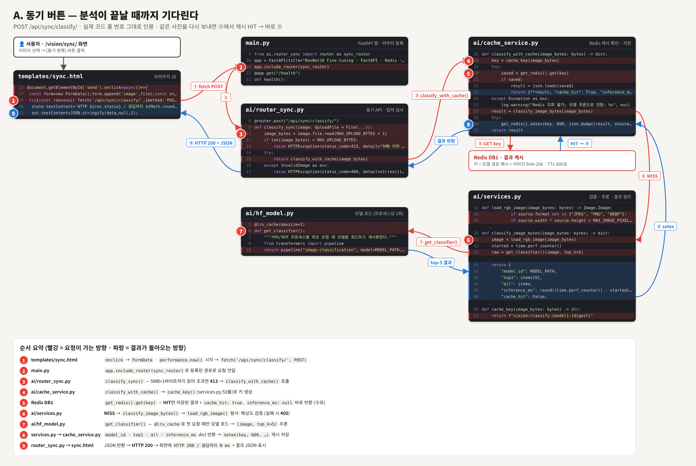
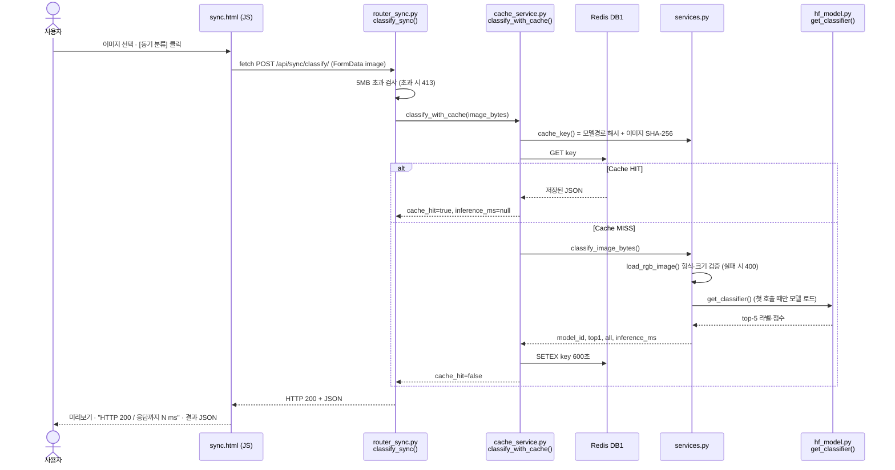
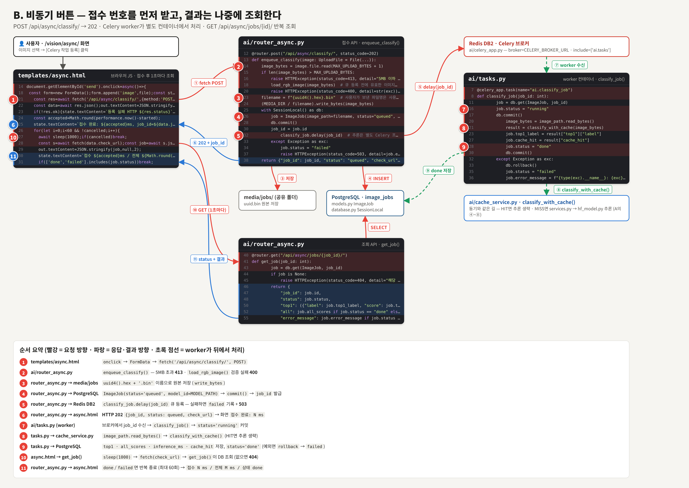
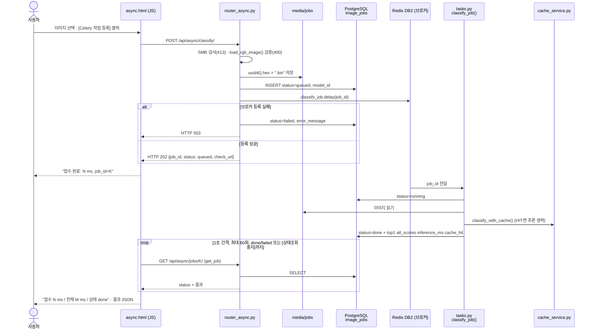

# 산출물 5. AI 분석 버튼 처리 파이프라인

사용자가 화면에서 버튼을 누른 뒤 **어떤 파일의 어떤 함수가 어떤 순서로** 실행되는지 실제 코드 기준으로 정리했다.

| 화면 | 버튼 | 호출 API | 사용자가 받는 것 |
|---|---|---|---|
| `/vision/sync/` | **동기 분류** | `POST /api/sync/classify/` | 분석이 끝난 결과 (HTTP 200) |
| `/vision/async/` | **Celery 작업 등록** | `POST /api/async/classify/` → `GET /api/async/jobs/{id}/` 반복 | 접수 번호(202) → 1초마다 상태 확인 → 결과 |
| `/vision/async/` | 상태조회 중지 | (요청 없음) | 화면의 조회만 멈춤, **worker 작업은 계속됨** |

## A. 동기 버튼 처리 흐름

- 그림의 코드는 저장소의 실제 파일과 **줄 번호까지 같다.** 빨간 번호 ①~⑨를 따라가면 버튼 → API → 캐시 → 추론 → 응답 순서가 된다.
- 같은 사진을 다시 보내면 ⑤에서 **캐시 HIT** → ⑥⑦⑧을 건너뛰고 바로 ⑨로 돌아간다 (`cache_hit: true`, `inference_ms: null`).

시퀀스 다이어그램으로 보기 (Mermaid)

## B. 비동기 버튼 처리 흐름

- ①~⑥은 **web 컨테이너**에서 바로 끝나고(HTTP 202), ⑦~⑨는 **worker 컨테이너**가 뒤에서 처리한다 (초록 점선).
- 브라우저는 ⑩⑪을 1초마다 반복해 `done` 또는 `failed`가 될 때까지 상태를 조회한다 (최대 60회, [상태조회 중지]를 눌러도 worker 작업은 계속된다).

시퀀스 다이어그램으로 보기 (Mermaid)

## C. 실제 코드 연결표

| 단계 | 파일 | 함수 · 처리 | 다음 단계 |
|---|---|---|---|
| 동기 ①⑨ | `templates/sync.html` | 버튼 onclick → `fetch('/api/sync/classify/')`, `performance.now()`로 응답 시간 표시 | API-02 |
| 동기 ②③ | `main.py` → `ai/router_sync.py` | `classify_sync()` — `MAX_UPLOAD_BYTES+1`까지 읽어 413 판정 | `classify_with_cache()` |
| 동기 ④⑤⑧ | `ai/cache_service.py` | `classify_with_cache()` — Redis GET/SETEX, **Redis 오류 시 경고만 남기고 추론 진행** | HIT 반환 또는 추론 |
| 동기 ⑥ | `ai/services.py` | `cache_key()`, `load_rgb_image()`(형식·해상도·디코딩 검증), `classify_image_bytes()`(타이머 시작 → 추론) | `get_classifier()` |
| 동기 ⑦ | `ai/hf_model.py` | `get_classifier()` — `@lru_cache`, `pipeline("image-classification", model=MODEL_PATH, device=-1)` | `top1`, `all` |
| 비동기 ①⑥⑩⑪ | `templates/async.html` | `fetch` POST → `check_url`을 `sleep(1000)` 간격으로 최대 60회 조회 | API-03 |
| 비동기 ②~⑥ | `ai/router_async.py` | `enqueue_classify()` — 검증 → 파일 저장 → `ImageJob(queued)` → `classify_job.delay()` (실패 시 503) | worker |
| 비동기 ⑦~⑨ | `ai/tasks.py` | `classify_job()` — `running` → `classify_with_cache()` → `done` / 예외 시 `rollback` 후 `failed` | DB |
| 비동기 ⑩⑪ | `ai/router_async.py` | `get_job()` — 상태별로 `top1`·`all`·`error_message` 노출 (없으면 404) | 화면 |

## D. 실제 실행 화면으로 확인한 흐름

| 장면 | 화면에 보인 것 | 의미 | 증빙 |
|---|---|---|---|
| 동기 MISS | `HTTP 200 / 응답까지 37ms`, `cache_hit:false`, `inference_ms:21.77` | 모델이 실제 추론 | `evidence/05_web_api/web_sync_miss.png` |
| 동기 HIT (같은 사진) | `응답까지 10ms`, `cache_hit:true`, `inference_ms:null` | 추론 생략 | `evidence/05_web_api/web_sync_hit.png` |
| 비동기 접수 직후 | `접수 완료: 17ms, job_id=5`, `status:queued` | 202 = 접수일 뿐 | `evidence/05_web_api/web_async_1_queued.png` |
| 비동기 완료 | `접수 19ms / 전체 1042ms / 상태 done`, `inference_ms:22.18` | 실제 처리는 22ms, 나머지는 1초 조회 간격 | `evidence/05_web_api/web_async_2_done.png` |
| 서버 로그 | `POST /api/async/classify/ 202` → `GET /api/async/jobs/7/ 200` | 버튼 1회 = 접수 1회 + 조회 N회 | `evidence/05_web_api/web_access_log_polling.png`, `web_access_log_polling_loop.png` |
| worker 로그 | `Task ai.classify_job[...] received` → `succeeded in 2.87s: {'job_id': 6, 'status': 'done'}` | worker가 별도 프로세스에서 처리 | `evidence/07_infra/celery_worker_log.png` |
| 학습 범위 밖 입력 | 고양이 사진 → `bean_rust 0.525` | **기능은 정상, 모델은 "콩잎이 아님"을 판단하지 못함** | `evidence/05_web_api/web_sync_non_leaf_cat.png` |

> 위 화면 수치는 E1 운영 시점의 1회 측정이다. 같은 조건의 5회 반복 측정과 E3 기준 수치는 [산출물 6](06_성능비교_보고서.md)에 있다.

## E. 동기 vs 비동기 비교 결론

| 항목 | 동기 | 비동기 |
|---|---|---|
| 응답에 결과 포함 | ✅ | ❌ (job_id만) |
| 사용자가 응답을 받는 시간 | 추론 시간만큼 기다림 (E3 MISS 중앙값 21.09ms) | 즉시 (접수 중앙값 9.12ms) |
| 결과를 확인하는 시간 | 응답과 동일 | 조회 간격에 좌우 (스크립트 0.1초 간격 116ms, 화면 1초 간격 약 1초) |
| 기록 | 없음 | `image_jobs`에 상태·결과·모델 기록 |
| Redis 장애 시 | 캐시 없이 동작 (200, 응답 지연) | 접수 불가 (503 + failed 기록) |
| 분류 모델 | 동일 (같은 `MODEL_PATH`, 같은 캐시 공유) | 동일 |

- 비동기의 장점은 **추론이 빨라지는 것이 아니라 "접수와 처리를 분리"**하는 것이다. 추론이 오래 걸리는 모델이나 요청이 몰리는 상황에서 웹 서버가 묶이지 않는다.
